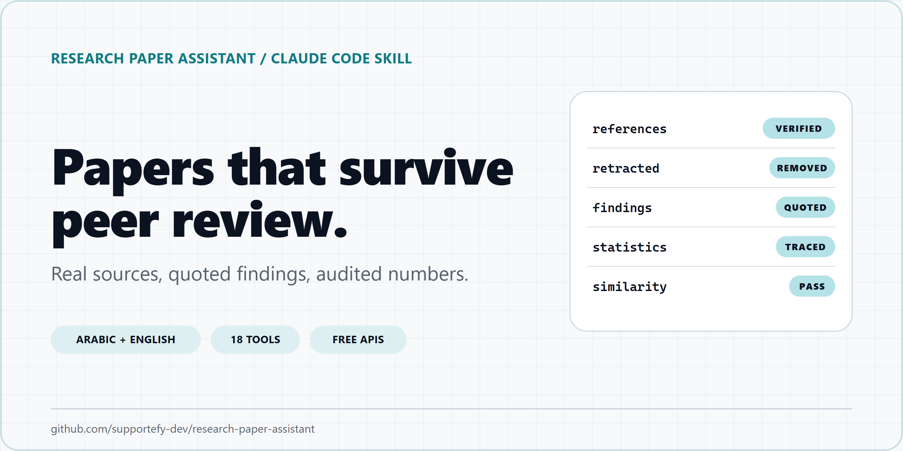
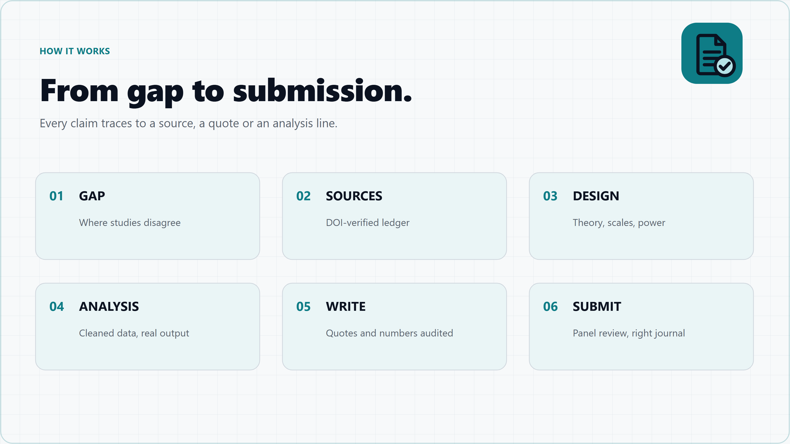
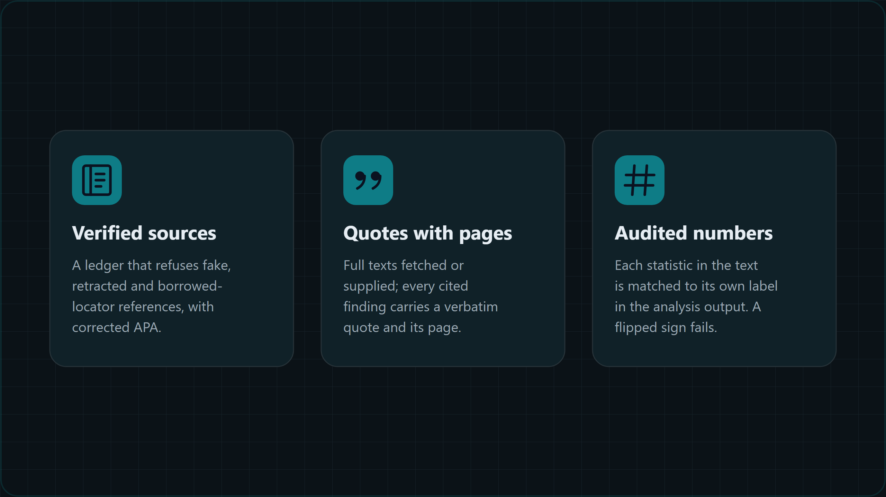
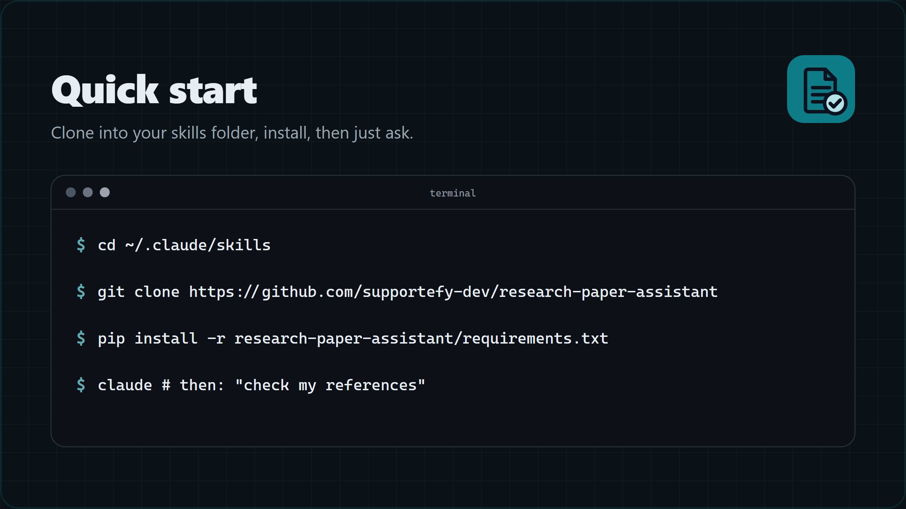

<p align="center">
  <picture>
    <source media="(prefers-color-scheme: dark)" srcset="assets/readme/hero-dark.png">
    
  </picture>
</p>

<h1 align="center">Research Paper Assistant</h1>

<p align="center">
  A Claude Code skill for academic papers, theses and proposals in Arabic and English, with integrity enforced by scripts rather than by promises.
</p>

<p align="center">
  
  
  
  
  
</p>

<p align="center">
  <a href="#install"><strong>Install</strong></a>
  &nbsp;&middot;&nbsp;
  <a href="QUICKSTART.md">Quick start</a>
  &nbsp;&middot;&nbsp;
  <a href="SYSTEM.md">Docs</a>
  &nbsp;&middot;&nbsp;
  <a href="CHANGELOG.md">Changelog</a>
  &nbsp;&middot;&nbsp;
  <a href="https://github.com/supportefy-dev/research-paper-assistant/issues">Report an issue</a>
</p>

## Features

<table>
  <tr>
    <td width="33%" valign="top">
      <br>
      <strong>Verified sources</strong><br>
      <sub>A source ledger that refuses fake DOIs, retraction notices and retracted papers.</sub>
    </td>
    <td width="33%" valign="top">
      <br>
      <strong>Quotes with pages</strong><br>
      <sub>Every cited finding carries a verbatim quote and its page, from open access or your PDF.</sub>
    </td>
    <td width="33%" valign="top">
      <br>
      <strong>Audited numbers</strong><br>
      <sub>Each statistic is matched to its own label in the analysis output; a flipped sign fails.</sub>
    </td>
  </tr>
  <tr>
    <td width="33%" valign="top">
      <br>
      <strong>Gaps from disagreement</strong><br>
      <sub>Finds where studies contradict each other and which populations and designs are missing.</sub>
    </td>
    <td width="33%" valign="top">
      <br>
      <strong>Clean data, real models</strong><br>
      <sub>Careless responders out first, then regression, mediation, CFA and PLS on your own CSV.</sub>
    </td>
    <td width="33%" valign="top">
      <br>
      <strong>Review before submission</strong><br>
      <sub>A six-reviewer panel, a similarity check and the right Q1/Q2 journal for the paper.</sub>
    </td>
  </tr>
</table>

## How it works

<picture>
  <source media="(prefers-color-scheme: dark)" srcset="assets/readme/how-it-works-dark.png">
  
</picture>

<details>
<summary>More visuals</summary>

<br>





</details>

## Works with

<table>
  <tr>
    <td align="center" width="50%"><br><strong>Claude Code</strong></td>
    <td align="center" width="50%"><br><strong>Any terminal</strong></td>
  </tr>
  <tr>
    <td align="center">Full<br><sub>the skill loads itself and runs all nine stages</sub></td>
    <td align="center">Scripts<br><sub>every script runs on its own with <code>--help</code></sub></td>
  </tr>
</table>

---

## What it is

A skill is a folder Claude Code reads when a request matches it. This one turns Claude into a research assistant that cannot quietly invent a reference, a quote or a number:

- **No source without a verified DOI or ISBN.** The source ledger refuses fake DOIs, retraction notices and retracted papers. A whole reference list can be checked in one command, including the common AI hallucination of a fake paper that borrows a real journal, volume and page.
- **No finding without a verbatim quote.** Full texts are fetched from open-access sources (or your own PDFs), and every cited finding must carry a quote with a page number.
- **No number without analysis output.** Statistics are computed on your data and every value in the Results section is checked against the matching label in the output (a flipped sign or a wrong df fails).
- **No ghostwriting.** Work that someone else will submit as their own is declined and turned into coaching.

All tools are free: OpenAlex, Crossref (with Retraction Watch data), Semantic Scholar, Europe PMC, Unpaywall, DOAJ, Open Library, OpenReview, eLife, plus a journal-ranking file you download.

## Who this is for

- Master's and PhD students writing their own thesis, in Arabic or English.
- Researchers and supervisors who want a reference list, a results section or a journal choice checked.
- Organisations writing reports that cite research.

Not for: producing work someone else will submit under their own name. The skill declines that and offers coaching instead.

## Table of Contents

- [Install](#install)
- [Compatibility](#compatibility)
- [What it does, stage by stage](#what-it-does-stage-by-stage)
- [How the checks look](#how-the-checks-look)
- [Safety model](#safety-model)
- [Honest limits](#honest-limits)
- [Troubleshooting](#troubleshooting)
- [Tests](#tests)
- [Contributing](#contributing)
- [License](#license)
- [بالعربية](#بالعربية)

## Install

Clone into your Claude Code skills folder:

```bash
git clone https://github.com/supportefy-dev/research-paper-assistant ~/.claude/skills/research-paper-assistant
pip install -r ~/.claude/skills/research-paper-assistant/requirements.txt
```

On Windows the skills folder is `%USERPROFILE%\.claude\skills\`. The [skills CLI](https://github.com/vercel-labs/skills) also works: `npx skills add supportefy-dev/research-paper-assistant`.

Then, in Claude Code, ask for anything research-related ("find me a gap on X", "check my references", "write my results from this CSV", "which Q1 journal fits this abstract", "جهزني للمناقشة"). The skill loads itself. [QUICKSTART.md](QUICKSTART.md) has the commands only.

### Optional setup

| What | Why | How |
|---|---|---|
| OpenAlex API key (free) | Without a key, everyone on your network shares 1,000 credits a day (a search costs 10). A key gives 10,000. | `curl -X POST https://api.openalex.org/api-keys -H "Content-Type: application/json" -d '{"email":"you@example.com"}'`, click the activation email, then save the key to `~/.config/research-paper-assistant/openalex.key` (one line) or set `OPENALEX_API_KEY` |
| `RESEARCH_MAILTO` | Faster Crossref, and required for Unpaywall full texts | Set it to your own email |
| SJR journal file | Quartiles (Q1-Q4) per category | Download from https://www.scimagojr.com/journalrank.php ("Download data") and pass `--sjr <file>` or set `SJR_CSV`. The site blocks scripts and the file may not be redistributed |

## Compatibility

| Requirement | Status |
|---|---|
| Python | 3.10 or newer |
| Required packages | `requests`, `numpy`, `scipy`, `pymupdf`, `pypdf`, `python-docx`, `openpyxl` ([requirements.txt](requirements.txt)) |
| Optional | `semopy` (CFA fit indices), `ffmpeg` and `whisper.cpp` (interview transcription, fully local), Microsoft Word (to update a generated table of contents and export PDF) |
| Operating system | Developed and tested on Windows 11. The scripts are plain Python and expected to work on macOS and Linux; the Word-to-PDF check uses Word on Windows |
| Host | Claude Code (the skill). Every script also runs from any terminal |
| Network | Free public APIs only; no account needed except the optional OpenAlex key |

## What it does, stage by stage

| Stage | Tools |
|---|---|
| 1. Topic and gap | literature search (OpenAlex, Crossref for Arabic journals), `gapmap.py` (where studies disagree, empty cells), `comap.py` (co-citation map: schools of thought, seminal papers, frontier) |
| 2. Literature | source ledger (`add`, `abstract`, `fix`), `snowball.py` (citation chasing with PRISMA counts), `evidence.py` (full texts, quotes with pages, claim audit, evidence trail) |
| 3. Verify sources | `verify --citations-file` (REAL / REAL with errors / RETRACTED / FABRICATED / UNVERIFIED, with corrected APA) |
| 4. Design | theory registry (30 theories, sources verified), red-team the design before data collection, `instruments.py` (validated scales, pilot item analysis, back-translation protocol, licence table), `effects.py` (effect sizes from the literature, power incl. mediation) |
| 5. Analysis | `autopsy.py` (careless responders, GRIM, Harman, statcheck), `analyze.py` (descriptives, correlation, regression with diagnostics, t-test, ANOVA, alpha), `analyze_sem.py` (mediation, moderation, CFA with CR/AVE/HTMT, PLS), `qual.py` (interviews: transcription, coding, kappa, themes with timestamps) |
| 6. Writing | IMRaD or the five-chapter Arab-university thesis, bilingual abstract, APA 7 in both languages |
| 7. Journal | SJR shortlist by category quartile, DOAJ and hijacked-journal checks, `journalfit.py` (house profile, fit score, desk-reject risk) |
| 8. Pre-submission | citation audit, numbers audit, `similarity.py` (paraphrase risk), `reviews.py` (real open peer reviews), a 6-reviewer panel, AI-use disclosure templates (Elsevier, Springer Nature, ICMJE, IEEE, T&F, theses), `build_docx.py` (Word with correct Arabic RTL, APA tables, university presets) |
| 9. After | `package.py` (OSF reproducibility zip), `watch.py` (new papers), defense preparation, `deliverables.py` (conference abstract, policy brief, visual abstract from real numbers) |

Every script has `--help`, and most have a `selftest`. The architecture, data formats and API limits are in [SYSTEM.md](SYSTEM.md).

## How the checks look

```
$ python -X utf8 scripts/scholar.py verify --citations-file refs.txt
| # | verdict      | as cited                                   | doi                       | detail                              |
| 1 | REAL         | Junco, R. (2012). Too much face and ...    | 10.1016/j.chb.2011.08.026 |                                     |
| 4 | REAL, ERRORS | Kirschner, P. A., & Karpinski (2011)...    | 10.1016/j.chb.2010.03.024 | year 2011 -> 2010                   |
| 5 | RETRACTED    | Wakefield, A. J., et al. (1998). Ileal...  | 10.1016/s0140-6736(97)... | retracted 2010 by notice ...        |
| 6 | FABRICATED?  | Hamdan, K., & Zoubi, R. (2021). TikTok...  |                           | its journal/volume/page belongs to a different paper ... |

$ python -X utf8 scripts/scholar.py numbers results.md --evidence analysis/output.txt
SIGN DIFFERS line 3: r = -.31  | Sleep correlated with GPA, r(194) = -.31, p < .001 ...
RESULT: FAIL (0 unsupported, 1 sign, 0 weak)
```

## Safety model

| Rule | How it is enforced |
|---|---|
| No invented sources | `scholar.py add` and `verify` resolve every DOI or ISBN against the registry; unresolvable, retracted and notice DOIs are refused |
| No invented quotes | `evidence.py claim add` refuses a quote that is not verbatim in the full text; `evidence.py audit` fails a cited finding without one |
| No invented numbers | `scholar.py numbers` fails any statistic missing from the analysis output; template mode fails any number before data exists |
| No paywall or bot bypass | Paywalled papers come from your own PDFs; sites that challenge scripts (SJR, some publishers) are never worked around |
| No ghostwriting | The authorship check in [SKILL.md](SKILL.md) declines work for someone else to submit as their own and offers coaching |
| Keys stay private | The OpenAlex key is read from an env var or `~/.config/research-paper-assistant/`, never printed, never written into a project; `package.py` refuses key files |

Reporting a security issue: see [SECURITY.md](SECURITY.md).

## Honest limits

- Regex extractions (direction of an effect in an abstract, sample sizes, scale reliability, a journal's typical methods) are **candidates** the agent confirms by reading; every output says so.
- Open peer reviews exist only for some fields (OpenReview, eLife, F1000); for business and education the skill falls back on published studies of reviewer comments.
- Paywalled papers are never bypassed: drop the PDF into `papers/` and the skill quotes from it.
- Quartiles come only from the SJR file you download; the skill never estimates one.
- A transcript from Whisper is ASR output until a human has checked it against the audio.

## Troubleshooting

| Symptom | Cause | Fix |
|---|---|---|
| `UnicodeEncodeError: 'charmap' codec` on Windows | The console is cp1252 | Run every script, and any ad-hoc Python, with `python -X utf8` |
| OpenAlex returns 429 or "budget" messages | The keyless pool is shared by your whole network | Add a free OpenAlex key (see [Optional setup](#optional-setup)) |
| Unpaywall skipped (HTTP 422) | Unpaywall rejects placeholder emails | Set `RESEARCH_MAILTO` to your own email |
| `SJR file not found` | scimagojr.com blocks scripts | Download the CSV in a browser and pass `--sjr <file>` |
| The Word file shows a placeholder table of contents | Word fields are filled on open | Accept Word's update prompt or press F9; the PDF recipe in `references/stages.md` updates fields first |
| CFA prints "approximation, not full CFA" | `semopy` is not installed | `pip install semopy` for fit indices; everything else works without it |
| `whisper-cli not found` | whisper.cpp is optional | Put `whisper-cli` on `PATH` or set `WHISPER_CLI`; the error message lists the download |

## Tests

```bash
python -X utf8 tests/run_tests.py          # every module's selftest + the planted-error regression (offline)
python -X utf8 tests/run_tests.py --live   # also checks a real and a fake DOI against Crossref
```

## Contributing

Read [references/module-contract.md](references/module-contract.md) first: it holds the data formats, the CLI conventions, the honesty rules every script enforces, and the testing rule (a positive case and a planted-error negative control before anything is reported done). The pull-request flow is in [CONTRIBUTING.md](CONTRIBUTING.md); please follow the [Code of Conduct](CODE_OF_CONDUCT.md).

## License

MIT, see [LICENSE](LICENSE). Built by [Supportefy](https://supportefy.com).

---

## بالعربية

<div dir="rtl">

مهارة لـ Claude Code لكتابة ومراجعة الأبحاث العلمية والرسائل الجامعية بالعربية والإنجليزية، تفرض النزاهة بالسكربتات لا بالوعود: لا مرجع بدون DOI أو ISBN متحقق منه، لا نتيجة مقتبسة بدون اقتباس حرفي مع رقم الصفحة، لا رقم إحصائي بدون مخرجات تحليل حقيقية على بيانات الباحث، ولا كتابة لعمل يقدمه شخص آخر باسمه.

تغطي المراحل من إيجاد الفجوة البحثية (أين تختلف الدراسات)، إلى الدراسات السابقة، والمنهجية (المقاييس المعتمدة، حجم العينة المبرر، نظرية لكل فرضية)، والتحليل (تنظيف البيانات، الانحدار، الوساطة والتعديل، CFA و PLS، تحليل المقابلات)، واختيار المجلة (الربع في SJR، كشف المجلات المختطفة)، والمراجعة قبل الإرسال (لجنة من ستة محكّمين افتراضيين، فحص التشابه، الإفصاح عن استخدام الذكاء الاصطناعي)، ثم ملف Word بإخراج عربي صحيح وقوالب لعدد من الجامعات العربية، والتحضير للمناقشة.

التثبيت: استنسخ المستودع داخل مجلد `~/.claude/skills/` ثم `pip install -r requirements.txt`. كل الأدوات مجانية.

</div>
